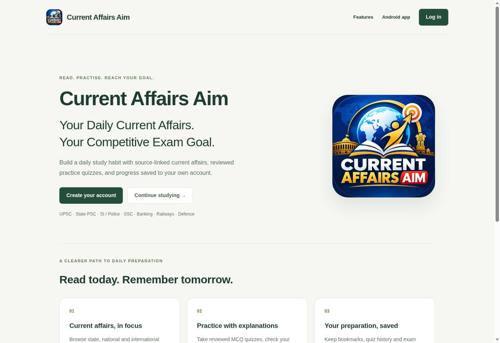
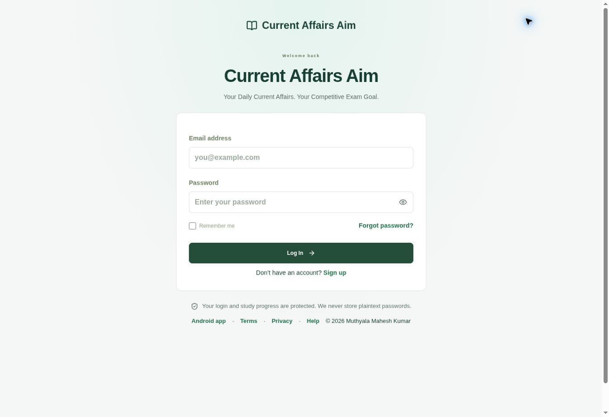
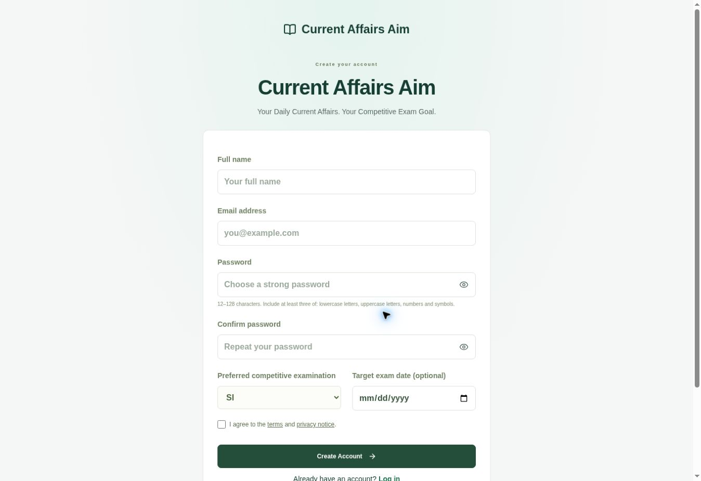

# Current Affairs Aim

**Your Daily Current Affairs. Your Competitive Exam Goal.**

Developed by **Muthyala Mahesh Kumar**.

[Open the live website](https://current-affairs-aim.r58144805.chatgpt.site/) · [Website tour](https://current-affairs-aim.r58144805.chatgpt.site/showcase) · [Log in](https://current-affairs-aim.r58144805.chatgpt.site/login) · [Android testing APK](https://current-affairs-aim.r58144805.chatgpt.site/android)

## Project

A current-affairs and competitive-exam preparation platform with state, national and international filters, reviewed MCQ quizzes, source links, publication dates, bookmarks, exam preferences and saved progress. The public homepage introduces the app; signed-in learners keep their dashboard at the same root URL.

The existing application uses React, TypeScript, Vinext/Vite, a Cloudflare Worker and D1. This repository contains only a compact showcase and selected public UI source. It is not the complete backend and is not a standalone deployable copy of the application. Authentication and private account data remain on the existing platform.

## Screenshots

These are actual captures of the public website. They do not claim native Android-device testing.

## Sample video

[Watch the short website walkthrough](assets/current-affairs-aim-walkthrough.mp4). It is assembled from actual captured website views, with titles explaining each screen; it is not a recording of a completed login or quiz attempt.

## Minimal code

- `ui/public-home.tsx`: public introduction component from the live project.
- `ui/public-home.css`: the component’s presentation styles; shared app tokens and button styles are defined in the private application.
- `ui/showcase-page.tsx`: public screenshot and video gallery.
- `SECURITY.md`: implemented controls and remaining limitations.
- `assets/`: public-page screenshots and walkthrough.

No environment files, backend code, database contents, API keys or signing credentials are included.

## Verification — 13 October 2026

209 backend/UI/security checks and TypeScript validation passed locally. Deployment and public-page checks are recorded in RELEASE-NOTES.md after completion. No real-user account or quiz history was modified for this showcase. Google indexing and store approval remain unconfirmed.

## Rights

© 2026 Muthyala Mahesh Kumar. Original source and assets: all rights reserved. Source publishers retain their rights to linked news material. No registered trademark or examination-authority affiliation is claimed.
